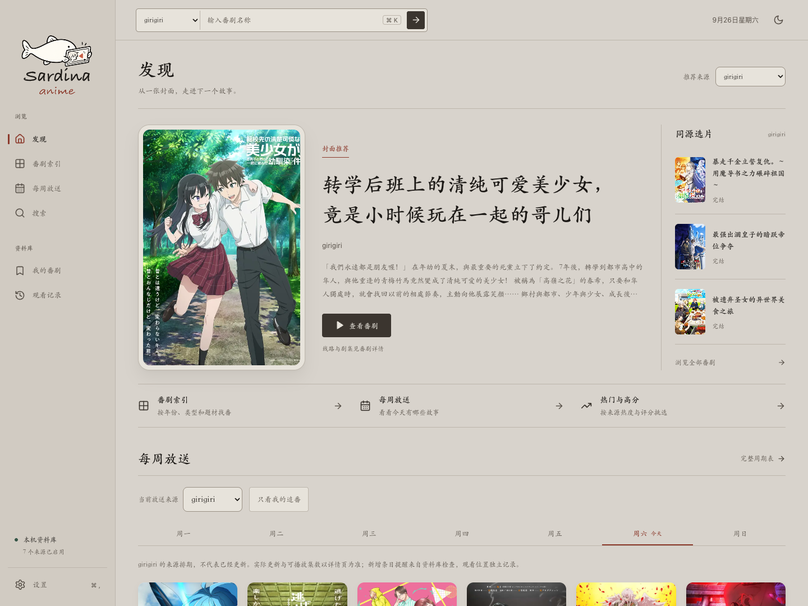
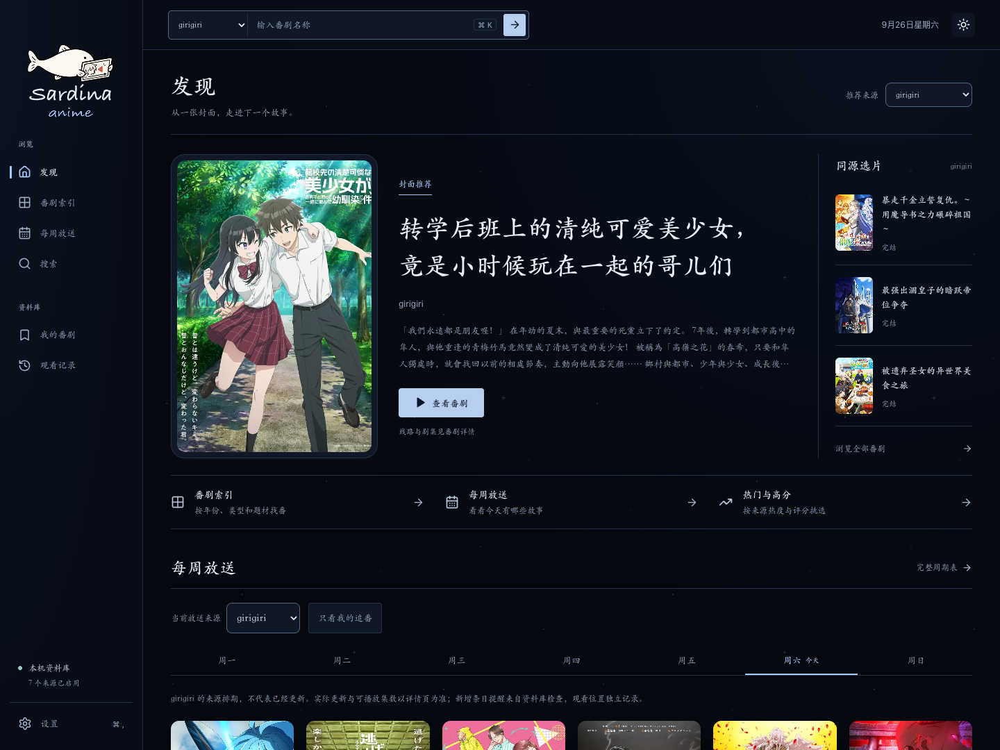

# Sardina Anime

A local anime discovery, tracking, and playback app for macOS, Windows, and localhost browsers—pairing a React + Electron client with a loopback Fastify + SQLite engine.

English · [简体中文](README.zh-CN.md) · [Releases](https://github.com/zzzfu411/Sardina-anime/releases)

| Light Theme | Dark Theme |
| --- | --- |
|  |  |

## Features

- **Multi-source discovery & catalog** — Ships adapters for `girigiri`, `AniCh`, `AkiAnime`, `erkuang`, `gugu`, `ledou`, and `xifan` with recommendations, genre/year filters, weekly broadcast schedules, and SSE search (including manual site CAPTCHA forwarding without OCR).
- **MP4 & HLS playback** — Session-registered loopback media proxy (`/api/v1/media`) with HTTP `Range` streaming, multi-line switching with position resume, speed controls, Picture-in-Picture, and auto-next episode.
- **Danmaku & ratings** — Optional `girigiri` danmaku overlay with font-size/opacity settings, entry-time viewer snapshots, and Bangumi + source ratings with manual subject linking.
- **Local SQLite library** — Persists watch states (`wish` / `watching` / `completed` / `on-hold`), update checks, and 5-second playback checkpoints in SQLite (`REVANIME_DATA_DIR`), shared between desktop and browser modes with versioned JSON backup and transactional restore.

## Installation & Quick Start

Prebuilt preview bundles include the full runtime (no Node.js required):

- **Windows 10/11 (x64)** — [Installer `.exe`](https://github.com/zzzfu411/Sardina-anime/releases/download/v0.7.2-windows.1/Sardina-anime-0.7.2-windows-x64-setup.exe) · [Portable `.zip`](https://github.com/zzzfu411/Sardina-anime/releases/download/v0.7.2-windows.1/Sardina-anime-0.7.2-windows-x64.zip) · [v0.7.2-windows.1 notes & SHA-256](https://github.com/zzzfu411/Sardina-anime/releases/tag/v0.7.2-windows.1) (unsigned preview; see [docs/WINDOWS-RELEASE.md](docs/WINDOWS-RELEASE.md))
- **macOS 12+ (Apple Silicon)** — [`.dmg`](https://github.com/zzzfu411/Sardina-anime/releases/download/v0.7.2/Sardina-anime-0.7.2-arm64.dmg) · [`.zip`](https://github.com/zzzfu411/Sardina-anime/releases/download/v0.7.2/Sardina-anime-0.7.2-arm64.zip) · [v0.7.2 notes & SHA-256](https://github.com/zzzfu411/Sardina-anime/releases/tag/v0.7.2) (unsigned/unnotarized preview)

To run from source, install **Node.js 24** and **pnpm 9.15.9**:

```sh
git clone https://github.com/zzzfu411/Sardina-anime.git
cd Sardina-anime
pnpm install --frozen-lockfile
pnpm build
pnpm start
```

`pnpm start` launches the `127.0.0.1` engine and opens an authenticated browser session (macOS users can also double-click [Start Web.command](<Start Web.command>) after building). Data defaults to `~/Library/Application Support/Revanime/` on macOS and `%APPDATA%\Revanime\` on Windows, overridable via `REVANIME_DATA_DIR`.

```sh
pnpm desktop         # launch Electron window against the local engine
pnpm package:mac     # build arm64 DMG and ZIP on Apple Silicon macOS
pnpm package:win     # build x64 installer and ZIP on Windows
pnpm verify:desktop  # smoke-test the packaged desktop app in an isolated data dir
```

## Development & Documentation

```sh
pnpm check     # TypeScript check + Vitest fixture/engine suite + production build
pnpm test:e2e  # Playwright Chromium end-to-end suite with synthetic test media
```

- [docs/ARCHITECTURE.md](docs/ARCHITECTURE.md) — Monorepo layout, single-instance lock lifecycle, and `/api/v1` endpoints
- [docs/SOURCES.md](docs/SOURCES.md) & [docs/ADDING_SOURCES.md](docs/ADDING_SOURCES.md) — Source coverage matrix and `AnimeSource` adapter guide ([types.ts](packages/engine/src/sources/types.ts))
- [docs/DANMAKU.md](docs/DANMAKU.md) & [docs/RATINGS.md](docs/RATINGS.md) — Danmaku protocol, audience lease rules, and Bangumi score matching
- [docs/VALIDATION.md](docs/VALIDATION.md) — Playback and packaging verification records
